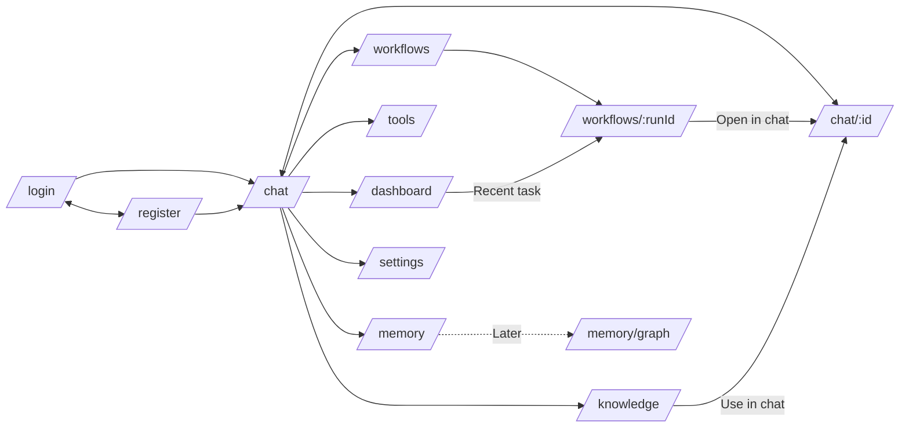

# NEXUS — Page Specifications

| | |
|---|---|
| **Document** | `nexus docs/PAGE_SPECIFICATIONS.md` · version **0.1 (draft for owner review)** |
| **Date** | 2026-10-18 |
| **Depends on** | `nexus docs/PRD.md` v0.1 (requirement IDs such as `FR-PLN-1`), `nexus docs/PROJECT_IMPLEMENTATION.md` (route list, API map, steps), `nexus frontend/` mockups and assets |
| **Status** | Specification only. **No page is implemented.** |

## 1. How to read this document

### 1.1 Evidence labels (same as the PRD)

| Label | Meaning |
|---|---|
| **[V]** | Verified in a project file (source given) |
| **[O]** | Owner-stated requirement or decision |
| **[R]** | Recommendation by the documentation author, not approved |
| **[A]** | Assumption |
| **[Q]** | Open question; collected in section 12 as `PQ-n` (page questions). PRD questions keep their `Q-n` numbers. |

### 1.2 What this document does and does not decide

- It defines **what each page is for, what it contains, in what order, how users reach it, what they can do, how it adapts, and when it is correct.**
- It does **not** define visual styling, colours, typography, motion details or copywriting. Those belong to the design, content and animation documents (Phase 2). Where a page needs them, this document only states *that* a behaviour exists.
- **The website repository is not available** [V: absent]. Existing pages, routes, router library, components and state handling are unknown. Every statement about "existing" pages comes from the legacy status report (S3 in the PRD) and is **[A]** until the repo is inspected (see PQ1).

### 1.3 Provisional breakpoints (not defined in any source)

No source defines breakpoints or device targets (PRD Q9). To keep this document testable, the following are **[R], provisional**, and can be changed in one place:

| Name | Width | Typical use |
|---|---|---|
| Desktop | ≥ 1280 px | Three-column chat, side panels visible |
| Tablet | 768–1279 px | Collapsible sidebar, panels become drawers |
| Mobile | < 768 px | Single column, navigation drawer, bottom sheets |

---

## 2. Route map

### 2.1 Routes

| ID | Route | Page | Access | Release | PRD refs | Source |
|---|---|---|---|---|---|---|
| PG-01 | `/login` | Login | Public | MVP | FR-AUTH-1 | O S5 |
| PG-02 | `/register` | Register | Public | MVP | FR-AUTH-1 | O S5 |
| PG-03 | `/chat` | Chat — new-chat setup / empty state | Authenticated | MVP | FR-AGT-1, FR-CHAT-1 | O S5 |
| PG-03 | `/chat/:conversationId` | Chat — active conversation | Authenticated (owner only) | MVP | FR-CHAT, FR-UND, FR-PLN, FR-RAG-3, FR-TOOL, FR-EVAL, FR-VIS | O S5 |
| PG-04 | `/knowledge` | Knowledge | Authenticated | MVP (PDF/DOCX), v1.0 (all types) | FR-ING, FR-RAG, FR-DATA-1 | O S5 |
| PG-05 | `/memory` | Memory | Authenticated | v1.0 | FR-MEM | O S5 |
| PG-06 | `/workflows` | Workflows — run history | Authenticated | v1.0 | FR-VIS-2, NFR-OBS-1 | O S5 |
| PG-06 | `/workflows/:runId` | Workflows — run detail | Authenticated (owner only) | v1.0 | FR-VIS-2, NFR-OBS-1 | O S5 |
| PG-07 | `/tools` | Tools | Authenticated | v1.0 | FR-TOOL | O S5 |
| PG-08 | `/dashboard` | Dashboard | Authenticated | v1.0 | FR-UI-1 | O S5 |
| PG-09 | `/settings` | Settings | Authenticated | v1.0 | FR-AUTH-2, FR-MEM-3, FR-LRN-2, FR-DATA-1, FR-UI-2/4 | O S5 |
| PG-10 | `*` | Not found | Any | MVP | — | R |
| PG-11 | (no route) | Global system states | Any | MVP | NFR-REL-1, NFR-USE-1 | R |
| PG-12 | `/dev/graph` | Agent-graph replay demo | Development builds only | MVP | FR-VIS-1 | R (Guide Step 2.A.3) |
| PG-13 | `/memory/graph` | Memory graph view | Authenticated, Neo4j profile on | Later | FR-DEP-2 | R (Guide Step 5.B.3) |

The route names for the seven main pages follow the owner's page list (Dashboard, Chat, Memory, Knowledge, Workflows, Tools, Settings) [O S5] and the route set in Guide Step 1.A.1 [R]. **The router library and exact existing paths are unknown** (PQ1).

### 2.2 Default landing

After login the user lands on **`/chat`** [R]. Rationale: the primary persona (P-A) works in chat; the only persona evidence in the sources is a chat-style request. Unresolved: PQ3.

### 2.3 Navigation map

### 2.4 Route rules

| Rule | Behaviour | Source |
|---|---|---|
| Unauthenticated user opens a protected route | Redirect to `/login`, return to the original route after login | R |
| Authenticated user opens `/login` or `/register` | Redirect to `/chat` | R |
| Resource not owned or non-existent (`/chat/:id`, `/workflows/:runId`) | Show the Not-found page; **never reveal that the resource exists** | O S5 (isolation); R |
| A run is awaiting approval | Opening its conversation restores the approval panel | FR-PLN-1 |
| Filters and tabs | Stored in the URL query (for example `?tab=episodic`) so the page can be reloaded or shared with the same state | R (PQ16) |

---

## 3. Shared layouts

### L1 — `AuthLayout` (Login, Register)
| Area | Content |
|---|---|
| Brand zone | NEXUS logo and name, one-line product description |
| Form card | Centred form; error summary above fields |
| Footer | Link to the other auth page |
Responsive: card centred on desktop/tablet; full-width with page padding on mobile; brand zone collapses to a compact header.
Missing: whether a hero/illustration is wanted (PQ12).

### L2 — `AppShell` (every authenticated page)
| Region | Content | Notes |
|---|---|---|
| **Sidebar** | Logo + wordmark; **New chat** button; main navigation in the owner's order **Dashboard, Chat, Memory, Knowledge, Workflows, Tools, Settings** [O S5]; recent conversations grouped by date (legacy "history by date" [V S3, reported]); service status pill (for example "Ollama running · qwen3:4b") | Collapsible with a layout animation; active item indicator |
| **Content outlet** | The routed page | Page transition (animation detail in the animation document) |
| **Global banner slot** | Offline, backend down, Ollama unavailable, queue position | See PG-11 |
| **Toast and dialog layers** | Non-blocking confirmations, modals, drawers | One focus trap at a time |

Mockup deviation **[R, PQ4]**: `nexus_ui_mockup.png` shows the agent toggles and presets inside the sidebar. The PRD requires agent selection *per chat* (FR-AGT-1/3). To stay consistent, this specification places agent selection in the **chat page** (new-chat setup panel and header popover) and treats the mockup as visual direction only.

Responsive: Desktop sidebar fixed and collapsible; Tablet collapsed to icons with an overlay on tap; Mobile hidden behind a menu button as a drawer.

### L3 — `ChatLayout` (inside AppShell, chat routes only)
| Column | Content | Desktop | Tablet | Mobile |
|---|---|---|---|---|
| Centre | Chat header, message list, composer | Visible | Visible | Visible |
| Right panel | **Agent graph** and run status | Visible, collapsible | Bottom drawer or tab | Compact step list in a sheet |

### L4 — `PageLayout` (Dashboard, Knowledge, Memory, Workflows, Tools, Settings)
| Order | Section |
|---|---|
| 1 | Page header: title, one-line description, primary action (right) |
| 2 | Optional toolbar: search, filters, tabs |
| 3 | Main content (cards, tables or forms) |
| 4 | Optional detail drawer (right on desktop, full-screen on mobile) |

### L5 — `MinimalLayout` (Not found)
Centred message with logo and two actions. No sidebar if the user is unauthenticated.

---

## 4. Reusable sections and components

| Component | Purpose | Used on |
|---|---|---|
| `PageHeader` | Title, description, primary/secondary actions | PG-04…PG-09 |
| `Composer` | Text input, attach, voice input, send/stop | PG-03 |
| `MessageList` / `MessageBubble` | Conversation display with streaming | PG-03 |
| `UnderstandingCard` | Shows the structured JSON understanding (collapsible) | PG-03, PG-06 detail |
| `PlanApprovalPanel` | Editable plan with approve / re-plan | PG-03 (replayed read-only in PG-06 detail) |
| `AgentSetupPanel` + `PresetChips` + `AgentToggleList` | Choose preset and agents; locked Controller and Reasoning | PG-03; defaults in PG-09 |
| `AgentGraph` | Block-diagram graph with node states | PG-03, PG-12, PG-06 detail (static replay) |
| `ToolCard` + `ApprovalDialog` | Tool proposals, code approval, results | PG-03, PG-07 |
| `SourceChips` + `SourceDrawer` | Citations `[n]` and snippet viewer | PG-03, PG-04 inspector |
| `MemoryProposalChips` | Save / Edit / Dismiss proposals | PG-03, PG-05 tray |
| `FeedbackButtons` | Thumbs up/down with optional comment | PG-03 |
| `FileUploadZone` + `FileStatusChip` | Drag-and-drop upload and processing status | PG-03 composer, PG-04 |
| `DataTable` | Sortable, filterable, paginated table | PG-04, PG-06, PG-07 |
| `MetricCard` / `HealthCard` | Single metric or service state | PG-08 |
| `StatusChip` | Run, file or tool state | PG-04, PG-06, PG-07 |
| `ConfirmDialog` | Destructive confirmation (typed phrase or password) | PG-04, PG-05, PG-09 |
| `EmptyState`, `ErrorState`, `Skeleton` | Standard states with a next step | All |
| `Banner`, `Toast` | Global and transient messages | L2 |

**Reuse rule [R]:** these components must use the shared theme CSS variables of the existing theme engine (Dark, Light, System, Aurora, Ocean, Midnight [V S3, reported]) and the motion tokens defined in the animation document; no page defines its own colours or timings.

---

## 5. Cross-page standards

### 5.1 Standard states every page must define

| State | Rule |
|---|---|
| **Loading** | Skeleton that matches the final layout; no blocking spinner over the full page; announced to assistive technology (`aria-live="polite"`) [NFR-ACC-1] |
| **Empty** | Explains what the page is for and offers one primary next action |
| **Error** | Safe message (no stack traces, tokens or file contents), reason category, and a Retry or next step |
| **Partial failure** | A failing card or section shows its own error; the rest of the page stays usable |
| **Unauthorised / not found** | Not-found page for foreign resources; redirect to login for expired sessions |

### 5.2 Global behaviours

| Topic | Behaviour | Source |
|---|---|---|
| Reduced motion | Page transitions and animations are instant when the OS setting or the in-app setting is on | FR-UI-4 |
| Keyboard | Every action reachable by keyboard; visible focus; dialogs trap focus and restore it on close | NFR-ACC-1 |
| Destructive actions | Always a confirmation; account deletion requires the password (backend-enforced) | Guide 5.D.1 [R] |
| Hidden reasoning | No raw model "thinking" text on any page | FR-VIS-2 |
| Language | English only in v1 | NFR-I18N-1 [R] |

### 5.3 Global system states (PG-11)

| State | Trigger | Presentation | Recovery |
|---|---|---|---|
| Session restoring | App start, refresh in flight | Splash/skeleton, no login flash | Auto; on failure go to `/login` |
| Session expired | 401 after refresh failed | Redirect to login with message | Log in; return to previous route |
| Backend unreachable | Network error to API | Global banner + page-level retry | Retry; check service health |
| Ollama unavailable | HTTP 503 `llm_unavailable` | Help card: how to start Ollama, Retry button | Start Ollama; retry |
| Queued | GPU busy | Banner/inline "Position n in queue" | Wait or cancel |
| Offline browser | No network | Offline banner; actions disabled | Auto-reconnect |
| Rate limited | HTTP 429 | Toast with wait time | Wait |

---

## 6. Authentication pages

### PG-01 — Login `/login`

| Item | Specification |
|---|---|
| **Purpose** | Let a registered user sign in to reach their conversations, files and memories. |
| **Target user** | All personas (P-A…P-D). |
| **Layout** | L1 AuthLayout. |
| **Content hierarchy** | 1 Brand header · 2 Heading "Sign in" · 3 Error summary (if any) · 4 Email field · 5 Password field with show/hide · 6 Submit · 7 Link to Register |
| **Section order** | As above, single column. |
| **Navigation** | In: direct URL, redirect from protected routes, logout. Out: `/chat` (or the stored return route); `/register`. |
| **Primary action** | Sign in. |
| **Secondary actions** | Go to Register; show/hide password. |
| **Responsive** | Card centred on desktop/tablet; full-width form on mobile with comfortable tap targets. |
| **Loading** | Submit button shows progress and is disabled; fields stay editable only after failure. |
| **Empty** | N/A. |
| **Error** | One generic message for wrong email or password (no hint which); validation errors beside fields; 429 shows wait message; network error uses the global banner. |
| **Data / API** | `POST /auth/login`; then `GET /auth/me` [Guide §0.6, R]. |
| **Missing information** | "Forgot password" and "Sign in with Google" are **not specified and excluded** in v1 (D5 pending); guest access (PQ2); terms/privacy links not specified. |

**Acceptance criteria**
- PG-01-AC1: Correct credentials land on `/chat` (or the stored return route) without a second login prompt.
- PG-01-AC2: Wrong email and wrong password produce the identical visible message.
- PG-01-AC3: An authenticated user who opens `/login` is redirected to `/chat`.
- PG-01-AC4: The form is fully usable by keyboard only, and errors are announced to assistive technology.
- PG-01-AC5: No password or token appears in the URL, console output or logs.

### PG-02 — Register `/register`

| Item | Specification |
|---|---|
| **Purpose** | Create a local account so data is isolated per user (FR-AUTH-1). |
| **Target user** | New users (P-A, P-B). |
| **Layout** | L1. |
| **Content hierarchy** | Brand header · Heading "Create your account" · Name · Email · Password (with requirement hint) · Submit · Link to Login |
| **Navigation** | In: link from Login. Out: `/chat` after success; `/login`. |
| **Primary action** | Create account. |
| **Secondary actions** | Go to Login; show/hide password. |
| **Responsive** | Same as PG-01. |
| **Loading / Empty** | As PG-01 / N/A. |
| **Error** | Duplicate email (conflict message); password too short or too long (8–72 bytes [R]); validation beside fields. |
| **Data / API** | `POST /auth/register`, then login flow. |
| **Missing information** | E-mail verification, password-reset and admin bootstrap are not in scope (PRD 6.2); whether to auto-login after registration (assumed yes [A]); required fields beyond name/email/password (PQ5). |

**Acceptance criteria**
- PG-02-AC1: A new user is registered and reaches `/chat` in one flow.
- PG-02-AC2: A duplicate email shows a clear message and keeps the other entries.
- PG-02-AC3: Passwords outside the allowed length are rejected before submission and by the server.

---

## 7. Chat (PG-03)

### PG-03 — Chat `/chat`, `/chat/:conversationId`

| Item | Specification |
|---|---|
| **Purpose** | The primary workspace: converse with NEXUS, see how it works, and approve plans, tool runs and memories. Satisfies FR-CHAT, FR-UND, FR-CTL, FR-AGT, FR-PLN, FR-RAG-3, FR-TOOL, FR-EVAL, FR-VIS, FR-FDB. |
| **Target user** | Primary P-A; also P-B, P-C. |
| **Layout** | L2 → L3 ChatLayout. |
| **Variants** | **A. New-chat setup** (no conversation configuration yet) · **B. Active conversation** · **C. Run awaiting a user decision** (plan or tool). |

#### 7.1 Variant A — New-chat setup (`/chat`)

| Order | Section | Content |
|---|---|---|
| 1 | Header | "New chat" |
| 2 | **Agent setup panel** (cannot be skipped, FR-AGT-1) | Preset chips Fast / Balanced / Full; six agent toggles with **Controller and Reasoning locked on** and labelled "required"; "Auto-approve plans" switch; model profile selector (Fast = Qwen3 4B, Quality = Qwen3 8B) with a one-line VRAM note |
| 3 | Start action | "Start chat" enables the composer |
| 4 | Suggestion cards | Existing suggestion cards [V S3, reported] that send a predefined prompt (content not specified, PQ6) |
| 5 | Composer | Disabled until setup is saved |

Presets (FR-AGT-2): **Fast** = Reasoning only · **Balanced** = Reasoning + Retrieval + Memory + Evaluation · **Full** = all six. Manual toggle change switches the chip to "Custom".

#### 7.2 Variant B — Active conversation (`/chat/:conversationId`)

| Order | Section | Content |
|---|---|---|
| 1 | **Chat header** | Conversation title (rename), preset chip, small agent dots, "Agents" popover (note: "Applies from your next message"), graph panel toggle, overflow menu (delete) |
| 2 | **Message list** (scroll area, auto-scroll with a "jump to latest" control) | User messages; for Tier 2/3 an **UnderstandingCard** (collapsible, JSON viewable, FR-UND-4); **PlanApprovalPanel** for Tier 3 (see 7.3); **ToolCards**; assistant message with streaming text, Markdown/code rendering (FR-CHAT-3), citation chips `[n]` → SourceDrawer (FR-RAG-3), low-confidence flag (FR-EVAL-3); **FeedbackButtons**; **MemoryProposalChips** after the answer (FR-MEM-2) |
| 3 | **Run status strip** (between list and composer) | Current stage in words (Understanding, Planning, Retrieving, Reasoning, Evaluating), queue position, Stop button |
| 4 | **Composer** | Text area, attach (file upload with chips), voice input [V S3, reported], send ↔ stop |
| 5 | **Right panel: AgentGraph** | Nodes: Understanding, Controller, Memory, Learning, Planner, Retrieval, Execute, Reasoning, Evaluation, Final; states idle / active / waiting / done / skipped / disabled / error; click opens a drawer with summary, duration, and for Planner the plan, for Retrieval the sources (FR-VIS-1/2) |

#### 7.3 Variant C — Awaiting a decision

| Decision | Presentation | Actions | Rules |
|---|---|---|---|
| **Plan approval** (FR-PLN-1/2) | `PlanApprovalPanel` inline in the message list: goal, step cards (title, detail, tool/retrieval badges), inline edit, reorder (drag **and** move up/down buttons), add, delete, feedback box | **Approve** · **Re-plan with feedback** · **Approve and don't ask again in this chat** | 1–8 steps validated client-side; composer is disabled with the notice "Waiting for your plan decision" [R]; panel survives refresh and restart |
| **Python approval** (FR-TOOL-2) | `ApprovalDialog` (modal) with editable code, limits (10 s, no network, no file access) | **Run** · **Edit & Run** · **Deny** | Denied code never runs |
| **Memory proposals** (FR-MEM-2) | Chips under the answer | **Save** · **Edit** · **Dismiss** | Nothing saved before the click |

#### 7.4 Navigation

| Direction | Details |
|---|---|
| In | After login; sidebar "New chat" or a conversation; `/chat/:id` deep link; Dashboard "Start new chat"; Knowledge "Use in chat" (PQ7) |
| Out | Any sidebar page; "Open run details" link from a message → `/workflows/:runId`; source chip → drawer (no navigation) |

#### 7.5 Actions

| Primary | Secondary |
|---|---|
| Send message · Approve plan (while paused) | Attach file · voice input · stop generation · rename/delete conversation · change agents (applies to next message) · expand Understanding JSON · thumbs up/down · save/edit/dismiss memory · re-plan · open source · toggle graph |

Not specified by any source (so **not** in this spec): edit a sent message, regenerate an answer, copy-message button, message deletion, conversation search or pinning (PQ8).

#### 7.6 Responsive behaviour

| Breakpoint | Behaviour |
|---|---|
| Desktop | Sidebar + chat + agent graph side by side |
| Tablet | Sidebar collapsed; graph in a bottom drawer toggled from the header |
| Mobile | Single column; sidebar as a drawer; graph as a compact vertical step list in a sheet; plan steps use move-up/down buttons; approval dialogs full screen; composer sticks above the keyboard |

#### 7.7 States

| State | Behaviour |
|---|---|
| **Loading** | Skeleton message bubbles; header shows title skeleton |
| **Empty conversation** | Greeting line, suggestion cards, composer focused |
| **Streaming** | Tokens appear progressively with a subtle caret; Stop replaces Send |
| **Queued** | "Position n in queue" in the status strip; cancel available |
| **Awaiting approval** | Panel/dialog visible; composer disabled |
| **Ollama unavailable (503)** | Error card with how to start Ollama and a Retry button; user message kept |
| **Run failed** | Safe message + Retry; run remains visible in Workflows |
| **Stream interrupted** | Partial answer shown, marked "interrupted" (FR-CHAT-2) |
| **Plan expired** | Message "This plan expired"; action to start a new run |
| **Agent config missing (412)** | Setup panel is shown instead of the composer |
| **File processing failed** | Chip shows `failed` and the reason; message can still be sent without it |
| **Rate limited (429)** | Toast with wait time; composer re-enabled after the wait |
| **Disabled-agent hint** | Dismissible inline hint "Enable Planner for better results" (FR-CTL-2) |
| **Guest limit** | **Unresolved** (PQ2, PRD Q7) |

#### 7.8 Data and API (Guide §0.6, [R])
`GET/POST /conversations`, `GET/PATCH/DELETE /conversations/{id}`, `GET/PUT /conversations/{id}/agents`, `POST /runs`, `GET /runs/{id}`, `GET /runs/{id}/events` (SSE), `POST /runs/{id}/plan`, `POST /runs/{id}/tools/{tool_id}`, `POST /runs/{id}/cancel`, `POST /files`, `POST /feedback`, `GET /memory/proposals`, `POST /memory/proposals/{id}/decision`.

#### 7.9 Acceptance criteria
- PG-03-AC1: On a new conversation no message can be sent before agent configuration is saved; Controller and Reasoning cannot be switched off. (FR-AGT-1)
- PG-03-AC2: Selecting each preset sets exactly the agents defined in FR-AGT-2.
- PG-03-AC3: Changing agents during a run leaves that run unchanged and shows "Applies from your next message". (FR-AGT-3)
- PG-03-AC4: Answers stream progressively; Stop halts generation within 2 s *(prov.)* and the partial text is saved as interrupted. (FR-CHAT-2)
- PG-03-AC5: For a Tier-3 run the plan panel appears and **no later stage starts** until the user decides; a refresh or backend restart restores the panel; a duplicate decision resumes only once. (FR-PLN-1)
- PG-03-AC6: Every plan action (edit, reorder by drag and by buttons, add, delete, approve, re-plan, approve-and-don't-ask-again) produces the expected state in an automated UI test. (FR-PLN-2)
- PG-03-AC7: Every citation chip opens a drawer showing a real source file, page and snippet; an answer without evidence states that the material does not cover the question. (FR-RAG-3)
- PG-03-AC8: Python code never runs before **Run** or **Edit & Run** is pressed; **Deny** results in no execution. (FR-TOOL-2)
- PG-03-AC9: After an answer, memory proposals appear only when Memory is enabled; no memory exists until **Save** or **Edit** is chosen. (FR-MEM-2)
- PG-03-AC10: The agent graph marks disabled and skipped agents differently from done ones for recorded Tier 1, 2 and 3 runs. (FR-VIS-1)
- PG-03-AC11: No raw model reasoning text appears in the UI. (FR-VIS-2)
- PG-03-AC12: With Ollama stopped, the chat shows the help card and no unhandled error; the user's message is preserved. (NFR-REL-1)
- PG-03-AC13: With reduced motion on, no animation or transition longer than 0 ms remains on this page. (FR-UI-4)
- PG-03-AC14: All variants are usable by keyboard only; streaming and status changes are announced. (NFR-ACC-1)

---

## 8. Knowledge (PG-04)

| Item | Specification |
|---|---|
| **Purpose** | Manage the documents NEXUS can read and inspect what retrieval returns (FR-ING, FR-RAG, FR-DATA-1). |
| **Target user** | P-B (own material), P-A, P-C (evaluator inspects retrieval). |
| **Layout** | L4 PageLayout. |
| **Route** | `/knowledge` |

**Content hierarchy and section order**

| Order | Section | Content |
|---|---|---|
| 1 | Page header | Title "Knowledge", description, primary action **Upload files** |
| 2 | Upload zone | Drag-and-drop area (multi-file), allowed types and limits text; scope defaults to **personal knowledge base** on this page [R]; **this chat only** is chosen from the chat composer |
| 3 | Tabs | **My files** · **Preloaded knowledge** (read-only system KB: topics and counts) |
| 4 | Toolbar | Search by name; filters: type, scope, status |
| 5 | File table | Name, type icon, pages/slides, chunks, scope, status chip (`processing`, `ready`, `failed` + reason), size, date; row actions |
| 6 | Retrieval Inspector | Query box → results: chunk text, score, source, page; OCR marker where applicable |

**Navigation:** In — sidebar, composer "manage files" link. Out — "Use in chat" starts or opens a conversation (PQ7).

**Actions**
| Primary | Secondary |
|---|---|
| Upload files | Delete file (confirmation says indexed chunks are also removed) · Promote chat file to personal KB · Retry failed processing · Run inspector query · Filter/search |

**Responsive:** Desktop table with all columns; Tablet fewer columns (name, status, scope, actions); Mobile list of cards, upload via picker; Inspector below the list with full-width results.

**States**
| State | Behaviour |
|---|---|
| Loading | Table skeleton rows |
| Empty ("My files") | Explains supported types and shows Upload; preloaded tab remains populated |
| Processing | Live status per file (polling with backoff [R]) |
| Failed | Row shows reason (for example encrypted PDF, unsupported type, corrupt) |
| Rejected upload | Inline message: oversized, disallowed type, quota exceeded (limits provisional: 25 MB per file, 500 MB per user [R]) |
| Error | Section-level error with Retry |
| Inspector empty | "No matching evidence" (explains the threshold, no guessing) |

**Data / API:** `POST /files`, `GET /files`, `GET /files/{id}`, `DELETE /files/{id}`, `POST /files/{id}/promote`, `POST /knowledge/search`.

**Missing information:** file preview or download (PQ9); how many files/quota are displayed (PQ9); whether the preloaded knowledge can be browsed by topic or is only counted (PQ10).

**Acceptance criteria**
- PG-04-AC1: Uploading several mixed files returns immediately with `processing` and each reaches `ready` or `failed` with a reason, shown live without a page reload. (FR-ING-3)
- PG-04-AC2: Each supported format in FR-ING-1 appears with page/slide counts after processing; scanned or image inputs show an OCR marker. (FR-ING-1/2)
- PG-04-AC3: Deleting a file removes its row and its retrieval results (verified in the Inspector). (FR-RAG-4, FR-DATA-1)
- PG-04-AC4: Another user's files are never listed; requesting their IDs shows Not found. (NFR-PRIV-2)
- PG-04-AC5: Promoting a chat file makes it retrievable from a different conversation of the same user only. (FR-ING-4)
- PG-04-AC6: The Inspector shows score, source and page for each returned chunk and shows an explicit "no evidence" state when none pass the threshold. (FR-RAG-1/3)
- PG-04-AC7: The page is operable by keyboard, including an alternative to drag-and-drop. (NFR-ACC-1)

---

## 9. Memory (PG-05)

| Item | Specification |
|---|---|
| **Purpose** | Let the user see, search, edit and delete everything NEXUS remembers, and confirm proposed memories (FR-MEM-1…4). |
| **Target user** | P-A, P-B; P-C to verify consent behaviour. |
| **Layout** | L4. |
| **Route** | `/memory` (`?tab=long-term` or `?tab=episodic` [R]) |

**Content hierarchy and section order**
| Order | Section | Content |
|---|---|---|
| 1 | Page header | Title "Memory"; one-line explanation of what is stored and where (local database and local vector store [V S1: local-first]); **Delete all memories** (secondary, destructive) |
| 2 | **Pending proposals tray** | Proposals awaiting a decision: Save / Edit / Dismiss |
| 3 | Tabs | **Long-term** · **Episodic** |
| 4 | Toolbar | Search |
| 5 | Memory list | Text, kind, created/confirmed date, source run link; inline edit and delete |

**Navigation:** In — sidebar; chat proposal chips link here. Out — source run → `/workflows/:runId`. Later: `/memory/graph` (Neo4j profile).

**Actions:** Primary — **Save** a pending proposal. Secondary — Edit, Dismiss, Delete (with undo toast), Delete all (typed confirmation), Search.

**Responsive:** Tabs scroll horizontally on mobile; list items stack with action menu; tray stays at the top.

**States**
| State | Behaviour |
|---|---|
| Loading | List skeleton |
| Empty | "Nothing is remembered. NEXUS only saves what you confirm." with a link to chat |
| Memory disabled (per chat/global) | Banner explaining that recall and proposals are off, link to Settings |
| Error | Section error with Retry; edits that fail revert |

**Data / API:** `GET /memory`, `PATCH/DELETE /memory/{id}`, `DELETE /memory`, `GET /memory/proposals`, `POST /memory/proposals/{id}/decision`.

**Missing information:** whether importance or recency is shown (PQ11); memory export separate from account export (PQ11).

**Acceptance criteria**
- PG-05-AC1: A fresh account shows zero memories and an empty-state message; no memory appears without a Save action. (FR-MEM-2)
- PG-05-AC2: Save, Edit-then-Save and Dismiss each change the list and tray as specified and survive a page reload.
- PG-05-AC3: Delete removes the item from the list and from retrieval; Delete all requires a typed confirmation. (FR-MEM-3)
- PG-05-AC4: Memories of another user are never visible (Not found for their IDs). (NFR-PRIV-2)
- PG-05-AC5: Secret-looking text never appears as a proposal. (FR-MEM-4)

---

## 10. Workflows (PG-06)

### PG-06a — Run history `/workflows`

| Item | Specification |
|---|---|
| **Purpose** | Provide a history of every run so users and evaluators can inspect how answers were produced (NFR-OBS-1, FR-VIS-2). |
| **Target user** | P-C (primary), P-A, P-D. |
| **Layout** | L4. |
| **Content hierarchy** | Page header (title, description) → Toolbar (status, tier, date range, conversation) → Table: started, conversation, tier, preset, status, duration, evaluation score, retries → Pagination |
| **Navigation** | In: sidebar; Dashboard recent tasks; message "Open run details". Out: row → `/workflows/:runId`. |
| **Actions** | Primary: open a run. Secondary: filter, sort, refresh. |
| **Responsive** | Table → compact cards on mobile (tier, status, time, score). |
| **States** | Loading skeleton rows · Empty "No runs yet" with Start chat · Error with Retry · Filter with no result "Nothing matches" and Clear filters |
| **API** | `GET /runs` (filters, pagination) |
| **Missing** | Retention period of run history (PQ13). |

### PG-06b — Run detail `/workflows/:runId`

| Order | Section | Content |
|---|---|---|
| 1 | Header | Run id (short), status chip, tier, preset, model profile, duration, **Open in chat**, **Export JSON** [R] |
| 2 | Timeline | Ordered events: node, status (ok / skipped with reason / error), duration |
| 3 | Understanding | Structured JSON (read-only) |
| 4 | Plan | Proposed plan and the user's edits highlighted; decision taken |
| 5 | Sources | Chunks used with file, page, score |
| 6 | Tool executions | Tool, input summary, approved by user, status, duration |
| 7 | Evaluation | Checks passed/failed, score, retries, low-confidence flag |
| 8 | Agent graph (static replay) | Final node states |

**Actions:** Primary — Open in chat. Secondary — Export JSON, copy run id, expand/collapse sections.
**Responsive:** Sections stack; timeline becomes a vertical list; graph collapses into a list.
**States:** Loading skeleton · Run not found/not yours → Not-found page · Run still active → live updating banner ("This run is in progress; resume in chat") · Awaiting approval → link to the chat to decide · Error with Retry.
**API:** `GET /runs/{id}`, stored run events [Guide 2.D.2, R].
**Acceptance criteria**
- PG-06-AC1: The history lists only the signed-in user's runs; filters by status, tier and date work and persist in the URL. (NFR-PRIV-2)
- PG-06-AC2: The detail shows timeline, understanding, plan with user edits, sources, tool executions and evaluation for a completed Tier-3 run. (NFR-OBS-1)
- PG-06-AC3: A Tier-1 run shows skipped agents with reasons ("disabled by user" or "not needed for this tier"). (FR-CTL-2/3)
- PG-06-AC4: No hidden reasoning text appears. (FR-VIS-2)
- PG-06-AC5: A run owned by another user returns the Not-found page.

---

## 11. Tools, Dashboard, Settings, utility pages

### PG-07 — Tools `/tools`

| Item | Specification |
|---|---|
| **Purpose** | Show which tools NEXUS can use, how each is permitted, and what has been executed (FR-TOOL, NFR-OBS-1). |
| **Target user** | P-C, P-A (trust and transparency). |
| **Layout** | L4. |
| **Content hierarchy** | Page header → **Tool cards**: Calculator, File reader, Local knowledge search, Python (sandbox), Web search (shown as off by default, opt-in, later [O S5]); each card: description, permission level (Automatic / Needs your approval / Off), limits for Python (10 s, no network, no file access) → **Execution history** table: time, tool, status (done, error, denied), approved by user, duration, run link |
| **Navigation** | In: sidebar; tool card from chat. Out: run link → `/workflows/:runId`. |
| **Actions** | Primary: none required (read-mostly page). Secondary: filter history, open run, open Settings for related privacy options. |
| **Responsive** | Cards in a grid (3 → 2 → 1 columns); history table → cards on mobile. |
| **States** | Loading skeleton cards · Empty history "No tool has run yet" · Error with Retry · Sandbox unavailable shown as a card status |
| **API** | `GET /tools`, `GET /runs` with tool filter [R] |
| **Missing** | Whether users can switch individual tools on/off (PQ14); where the web-search opt-in lives (this page or Settings → Privacy) (PQ14); whether execution input/output is shown in full or summarised (PQ14). |

**Acceptance criteria**
- PG-07-AC1: The page lists the tools defined in FR-TOOL with the correct permission level; Python is labelled "needs your approval".
- PG-07-AC2: Web search is shown as off and cannot be used by default. (FR-TOOL-3)
- PG-07-AC3: History contains only the user's executions and links to the owning run.
- PG-07-AC4: Denied executions appear as `denied` and show that no code ran. (FR-TOOL-2)

### PG-08 — Dashboard `/dashboard`

| Item | Specification |
|---|---|
| **Purpose** | One glance at system health and the user's own usage and quality signals. Per-user only; there is no administrator console (FR-AUTH-2). |
| **Target user** | P-C, P-A, P-D. |
| **Layout** | L4. |
| **Content hierarchy** | 1 Page header + **Start new chat** · 2 Health cards: Ollama (model/profile), database, vector store, sandbox; Neo4j/Grafana only when enabled · 3 Metric cards: runs, average latency by tier, evaluation score, feedback ratio, files and chunks, memories · 4 Charts: runs per 14 days, tier split, evaluation trend · 5 Recent tasks list → Workflows |
| **Navigation** | In: sidebar. Out: Start chat → `/chat`; recent task → `/workflows/:runId`; health card → Settings (model) when relevant. |
| **Actions** | Primary: Start new chat. Secondary: Refresh, open Workflows. |
| **Responsive** | Cards 4 → 2 → 1 per row; charts stack; recent tasks as list. |
| **States** | Loading skeleton cards · **Empty (new user)** "No runs yet" + Start new chat · Partial failure per card · Service down card with how-to hint |
| **API** | `GET /dashboard`, `GET /health` [Guide 5.D.1, R] |
| **Missing** | The exact metric list and time ranges come from the guide [R], not from the PRD; confirm (PQ15). Legacy "admin dashboard" with mock data [V S3, reported] is **removed** (PRD 6.2). |

**Acceptance criteria**
- PG-08-AC1: Every number equals the corresponding database count for the signed-in user (spot-check against direct queries).
- PG-08-AC2: A new account shows the empty state and no fabricated or mock data. (FR-UI-1)
- PG-08-AC3: A stopped service appears as "down" on its card without breaking the page.
- PG-08-AC4: Charts have text alternatives (table or summary) for assistive technology. (NFR-ACC-1)

### PG-09 — Settings `/settings`

| Item | Specification |
|---|---|
| **Purpose** | Control account, model, agent defaults, privacy, memory, learning, data and appearance. |
| **Target user** | All authenticated users. |
| **Layout** | L4 with a section navigation (left on desktop, accordion on mobile). `?section=` in the URL [R]. |
| **Sections (in order)** | 1 **Account** — name, email, (password change: PQ5) · 2 **Model** — profile Fast (Qwen3 4B) / Quality (Qwen3 8B Q4) with VRAM guidance · 3 **Agents** — default preset for new chats · 4 **Privacy** — local-only indicator, web search toggle shown off / "later" · 5 **Memory** — enable/disable, Delete all memories · 6 **Learning** — enable/disable, Reset learning data (FR-LRN-2) · 7 **Data** — Export my data, **Delete account** (password required) · 8 **Appearance** — theme (Dark, Light, System, Aurora, Ocean, Midnight), glass intensity, ambient glow, reduced motion, font size [V S3, reported] |
| **Navigation** | In: sidebar; links from Memory, Dashboard, Tools. Out: none required. |
| **Actions** | Primary: Save changes (or auto-save, PQ5). Secondary: Export data; Reset learning; Delete all memories. Destructive: Delete account. |
| **Responsive** | Desktop two columns; Tablet section navigation as tabs; Mobile accordion with full-width controls. |
| **States** | Loading skeleton form · Save in progress and success toast · Validation error beside fields · Failed export with Retry · Destructive action pending confirmation |
| **API** | `GET/PUT /settings`, `GET /export`, `DELETE /account`, `DELETE /learning`, `DELETE /memory` [Guide 5.D.1, R] |
| **Missing** | Which legacy Profile / Account / Preferences modals [V S3, reported] are replaced by this page (PQ5); password change and email change (PQ5); save model (autosave vs explicit) (PQ5); whether appearance settings sync to the account or stay on the device — legacy used `localStorage` [V S3, reported] (PQ5). |

**Acceptance criteria**
- PG-09-AC1: Each setting persists after reload and is applied immediately to the UI where it affects appearance (theme, reduced motion, font size).
- PG-09-AC2: Reduced motion disables all animations and transitions on every page. (FR-UI-4)
- PG-09-AC3: Delete all memories and Reset learning data each require confirmation and leave zero rows afterwards. (FR-MEM-3, FR-LRN-2)
- PG-09-AC4: Delete account requires the password; afterwards no rows, vectors or files remain. (FR-DATA-1)
- PG-09-AC5: Export produces a file without password hashes or tokens. (FR-DATA-1)
- PG-09-AC6: No billing, subscription or admin controls exist. (FR-AUTH-2)

### PG-10 — Not found `*`

| Item | Specification |
|---|---|
| **Purpose** | Handle unknown URLs and resources the user cannot access, without leaking existence. |
| **Target user** | Anyone. |
| **Layout** | L5 (L2 when authenticated). |
| **Content hierarchy** | Logo → "We couldn't find that page" → short explanation → actions |
| **Actions** | Primary: Go to Chat. Secondary: Go to Dashboard; Sign in (when unauthenticated). |
| **Responsive** | Centred, single column. |
| **States** | Static. |
| **Acceptance criteria** | PG-10-AC1: Unknown routes, other users' conversation IDs and other users' run IDs all show this identical page. PG-10-AC2: Keyboard focus lands on the heading. |

### PG-11 — Global system states
Defined in section 5.3. **Acceptance:** PG-11-AC1 each state in the table is reproducible in a test (stop Ollama, kill the API, go offline, expire the session) and shows the specified presentation without unhandled errors. PG-11-AC2 no state exposes tokens, stack traces or file contents.

### PG-12 — Agent-graph demo `/dev/graph` (development only)
Purpose: replay recorded Tier 1, 2 and 3 event sequences against `AgentGraph` without the backend [R, Guide 2.A.3]. Excluded from production builds. **Acceptance:** PG-12-AC1 the route is absent in production builds; PG-12-AC2 each replay lights the expected nodes.

### PG-13 — Memory graph `/memory/graph` (Later)
Optional, only with the Neo4j profile. Out of v1.0 and not specified further until the graph-memory design is approved.

---

## 12. Missing information and open questions

| ID | Question / gap | Affects | Needed from |
|---|---|---|---|
| PQ1 | **Repository access.** Existing router library, route names, pages, components, state management, and which legacy pages already exist (A1/A2 unverified) | All pages, section 2 | Owner |
| PQ2 | Guest mode: keep the legacy 3-message limit or remove it? Is there a public landing page before login? (PRD Q7) | PG-01, PG-03, routes | Owner |
| PQ3 | Default landing after login: `/chat` (proposed) or `/dashboard`? | Section 2.2 | Owner |
| PQ4 | Agent controls location: this document places them in the chat (setup panel + header popover) instead of the sidebar shown in the mockup | L2, PG-03 | Owner |
| PQ5 | Settings details: legacy Profile/Account/Preferences modals; password and email change; autosave vs Save; whether appearance syncs to the account; required registration fields | PG-02, PG-09 | Owner |
| PQ6 | Suggestion-card content and whether they appear only in empty conversations | PG-03 | Owner/content doc |
| PQ7 | "Use in chat" from Knowledge: attach to current chat, start a new chat, or not offered | PG-04 | Owner |
| PQ8 | Message-level features: edit, regenerate, copy, delete messages; conversation search, pinning, date grouping rules (legacy grouped by date [V S3, reported]) | PG-03, L2 | Owner |
| PQ9 | Knowledge: file preview/download, quota display, final upload limits (25 MB / 500 MB are provisional) | PG-04 | Owner |
| PQ10 | Preloaded knowledge: browse by topic or counts only | PG-04 | Owner |
| PQ11 | Memory page: show importance/recency; separate memory export | PG-05 | Owner |
| PQ12 | Auth-page imagery or hero; copy and illustrations for empty and error states | L1, all states | Phase 2 content/imagery docs |
| PQ13 | Retention period for run history and events | PG-06 | Owner |
| PQ14 | Tools: per-tool on/off, location of the web-search opt-in, amount of input/output shown | PG-07, PG-09 | Owner |
| PQ15 | Dashboard metric list and ranges (currently from the guide) | PG-08 | Owner |
| PQ16 | URL-state policy for filters/tabs; keyboard shortcuts; notification policy | All | Owner/UX doc |
| PQ17 | Breakpoints and supported browsers (PRD Q9) | Section 1.3, responsive rows | Owner |

---

## 13. Coverage check against the PRD

| PRD requirement | Page(s) |
|---|---|
| FR-CHAT-1…4 | PG-03 (FR-CHAT-5 unresolved, PQ2) |
| FR-UND-4 | PG-03, PG-06b |
| FR-CTL-2 (hints) | PG-03 |
| FR-AGT-1…4 | PG-03 (setup, popover), PG-09 (default preset) |
| FR-PLN-1…3 | PG-03, PG-06b |
| FR-RAG-3/4, FR-ING-1…5 | PG-03 (citations, composer), PG-04 |
| FR-MEM-1…4 | PG-05, PG-03 (chips), PG-09 |
| FR-TOOL-1…4 | PG-03 (cards, approval), PG-07 |
| FR-EVAL-3 | PG-03 (flag), PG-06b |
| FR-LRN-2 | PG-09 |
| FR-VIS-1/2 | PG-03, PG-06b, PG-12 |
| FR-AUTH-1/2 | PG-01, PG-02, PG-09 |
| FR-UI-1…4 | All pages, L2, section 5.2 |
| FR-FDB-1 | PG-03 |
| FR-DATA-1 | PG-04, PG-05, PG-09 |
| FR-DEP-2 | PG-08 (optional cards), PG-13 |
| FR-UND-1/2/3, FR-CTL-1/3, FR-RAG-1/2, FR-EVAL-1/2, FR-LRN-1, FR-DEP-1/3 | Backend behaviour, not page-specific; surfaced indirectly in PG-03, PG-06b |

## 14. Revision history

| Version | Date | Change |
|---|---|---|
| 0.1 | 2026-10-18 | First draft from PRD v0.1, guide v2.0 and the mockup; repository not yet inspected |
