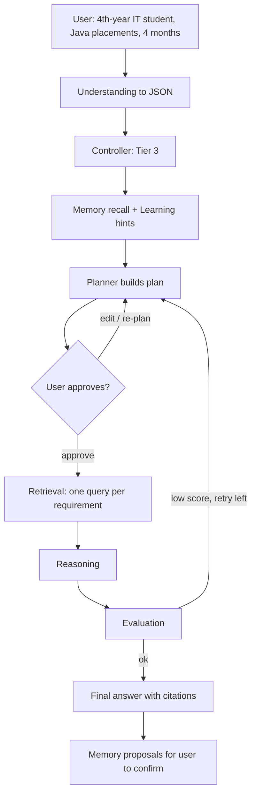

# NEXUS — Product Requirements Document (PRD)

| | |
|---|---|
| **Product** | NEXUS — AI Cognitive System (local-first, multi-agent assistant) |
| **Document** | `nexus docs/PRD.md` · version **0.1 (draft for owner review)** |
| **Date** | 2026-10-18 |
| **Status** | Documentation phase. **No implementation has started.** |
| **Owner** | Project team (final-year B.E. IT project, session 2026-27) |
| **Related documents** | `nexus_implementation_guide.md` v2.0 (architecture, steps, risks), `process.md` (tracker), `nexus_logo.*`, `nexus_ui_mockup.png` |

> **Positioning rule.** NEXUS is an *AGI-inspired experimental cognitive architecture*. It does **not** claim to be AGI (Source S1, Conclusion slide). No document, UI text or demo may claim otherwise.

---

## 1. How to read this document

### 1.1 Evidence labels

Every statement that matters carries one label so facts are never confused with ideas.

| Label | Meaning |
|---|---|
| **[V]** | **Verified** in a project file (source ID given). |
| **[O]** | **Owner-stated** requirement or decision, given in the project conversation and not (yet) in a file. |
| **[R]** | **Recommendation** by the documentation author. Not approved. |
| **[A]** | **Assumption.** Believed true, not verified. |
| **[Q]** | **Open question.** Needs an owner answer (section 15). |

### 1.2 Sources analysed

| ID | Source | Notes |
|---|---|---|
| S1 | `fpro.pdf` — seminar deck "AI Cognitive System" (title, TOC, introduction, problem statement, literature review, objectives, algorithms, block diagram, RAG architecture, key features, technology stack, conclusion, references) | Verified by reading |
| S2 | Block-diagram image (User → Input Interpretation → Executive Controller → Planner / Memory / Retrieval / Learning → Reasoning LLM → Evaluation → Final Response, with an Evaluation → Planner loop) | Verified by viewing |
| S3 | Legacy `process.md` status report for "Nexus (formerly Doctor Chatbot Website / MedAssist)", reported ~85 % complete | Verified as a *report*; its claims about code are **not** verified (see S6) |
| S4 | Owner's objectives, problem/solution statements and feature list given in the conversation | Owner-stated [O] |
| S5 | Owner's design answers (agents, tools, files, memory, UI, auth, Neo4j/Grafana) and final answers Q1-Q7 / A-B-C | Owner-stated [O] |
| S6 | **Website repository** | **Not available.** No source, dependencies, assets or config could be inspected. Everything about existing code is **[A]** until the repo is provided. |
| S7 | Hardware specification given by the owner: i7-13650H, RTX 4060 8 GB VRAM, 16 GB RAM, 512 GB SSD, Windows | Owner-stated [O] |

---

## 2. Product overview

**One-line description.** NEXUS is a local-first assistant in which specialised agents (planning, retrieval, reasoning, memory, learning, evaluation), coordinated by an Executive Controller, ground answers in the user's own documents and confirmed memories, and run entirely on the user's laptop. [V S1, S2; O S5]

**Research question it serves.** "How can independent AI capabilities be unified into a cognitive architecture for persistent, adaptive, goal-oriented behavior?" [V S1, Introduction]

**What NEXUS is**
- A web application (React + TypeScript frontend, FastAPI backend) with a unique, themed UI. [V S1 stack; O S5]
- A pipeline: Understand → Plan → Retrieve → Reason → Execute → Verify → Respond. [O S4/S5]
- Private by default: local Qwen3 through Ollama, local embeddings, local vector and relational storage. [V S1 "Private local inference + no per-token cost"]

**What NEXUS is not**
- Not AGI and not a claim of "human-like" intelligence beyond architectural inspiration. [V S1 Conclusion]
- Not a trained or fine-tuned model; "learning" means adapting strategies and ranking from feedback. [O S5]
- Not a commercial product with subscriptions or payments in v1. [O S5]

---

## 3. Problem statement

### 3.1 Problems (consolidated from S1 and S4)

The seminar deck (S1) and the owner's later list (S4) word the problems differently. Both are consolidated here; **which wording is canonical for the report is open [Q1]**.

| # | Problem | Source |
|---|---|---|
| P1 | **Context loss / limited memory.** LLM interactions do not keep or reuse relevant information across long or multi-session use. | V S1; O S4 |
| P2 | **Planning limitation / difficulty with complex tasks.** LLMs struggle to break complex goals into reliable, executable steps. | V S1; O S4 |
| P3 | **Tool and agent selection.** A single LLM may pick inappropriate tools or agents. | V S1 |
| P4 | **Reliability and self-correction / hallucination.** LLMs produce unsupported output and cannot reliably verify or fix it. | V S1; O S4 |
| P5 | **Fragmented capabilities.** Retrieval, reasoning, memory, planning and agents are researched and built separately, not as one system. | V S1; O S4 |
| P6 | **No end-to-end workflow.** Existing approaches rarely give a coordinated flow from query understanding to validated output. | O S4 |
| P7 | **Single-model dependency.** One LLM may not suit every task. | O S4 — see tension note below |

> **Tension to resolve [Q2].** P7's stated solution is "specialized agents/tools based on task requirements" [O S4], but the hardware decision is **one model (Qwen3) for all agents** to avoid VRAM-heavy model swapping [O S5]. This PRD therefore interprets "specialised" as specialised *prompts, contracts and tools per agent*, not different models. The owner should confirm that interpretation.

### 3.2 How NEXUS addresses each problem

| Problem | NEXUS capability (requirement IDs in section 7) |
|---|---|
| P1 | Multi-level memory (short-term, long-term, episodic) with user-confirmed saves — FR-MEM |
| P2 | Query decomposition and a user-approved Planner — FR-UND, FR-PLN |
| P3 | Executive Controller with tier routing and a permission-checked tool registry — FR-CTL, FR-TOOL |
| P4 | RAG with citations, "not in the material" behaviour, Evaluation Agent with bounded retry — FR-RAG, FR-EVAL |
| P5, P6 | One orchestrated pipeline over all capabilities — FR-CTL, FR-AGT |
| P7 | Per-agent prompts and tools on one local model; replaceable `LLMProvider` — FR-AGT, NFR-MOD |

---

## 4. Goals and objectives

### 4.1 Owner objectives [O S4] and seminar objectives [V S1]

| ID | Objective | Source |
|---|---|---|
| O1 | Integrate techniques from the selected research papers into one framework | S4 |
| O2 | Understand and decompose user queries into tasks and subtasks | S4 |
| O3 | Retrieve relevant knowledge using RAG, semantic search and keyword-based retrieval | S4 |
| O4 | Apply planning and reasoning for systematic multi-step problem solving | S4 |
| O5 | Use memory, agents and tools according to each task | S4 |
| O6 | Verify and evaluate outputs to improve reliability, relevance and accuracy | S4 |
| SO1 | AGI-inspired intelligence — human-like reasoning (architecturally inspired, not an AGI claim) | S1 |
| SO2 | Cognitive integration — combine memory, retrieval and reasoning | S1 |
| SO3 | Improve accuracy — reduce hallucinations using RAG | S1 |
| SO4 | Adaptive decisions — handle different tasks intelligently | S1 |
| SO5 | Privacy and scalability — secure, modular AI system | S1 |

### 4.2 Product goals derived from them

| Goal | Linked objectives | Measured by (section 9) |
|---|---|---|
| G1 A working end-to-end cognitive pipeline on the target laptop | O1, O2, O4, SO2 | AC-REL-1, AC-REL-2 |
| G2 Answers grounded in the user's documents with visible sources | O3, SO3 | AC-RAG |
| G3 The user stays in control (agents, plans, memory, code execution) | O5, SO5 | AC-CTRL |
| G4 The system verifies and improves its output within bounded cost | O6, SO4 | AC-EVAL |
| G5 Private, modular and replaceable components | SO5 | AC-PRIV, AC-MOD |
| G6 A polished, distinctive UI that makes the architecture visible | (S5 UI decisions) | AC-UX |

> Business goals (revenue, user counts, adoption) are **not defined** and are not invented here [Q3].

---

## 5. Target audience and personas

No user research exists in the project files [V: absent]. Personas below are **hypotheses** derived from the sources and must be validated [Q4].

| ID | Persona | Goal | Needs | Evidence |
|---|---|---|---|---|
| **P-A** | **Placement-preparing student** (e.g., a 4th-year IT student preparing for Java placements) | Get a personalised, editable preparation plan and ask technical questions grounded in study material | Plan he can edit before it runs; cited answers; privacy; works on a laptop | **V** S2 ("USER — Placement Goal"), S1 RAG slide demo prompt |
| **P-B** | **Learner with own study material** | Upload notes, slides, sheets and code, then ask questions about them | Broad file support, per-user isolation, deletable data | **A** (derived from the file-type requirement [O S5]) |
| **P-C** | **Evaluator / faculty reviewer** | See that the architecture really works: agents, evidence, evaluation | Visible agent graph, traceable runs, documented limits | **A** (academic context; S1 title slide shows a faculty guide) |
| **P-D** | **Project team member** | Build and maintain parallel tracks without conflicts | Clear contracts, modular components | **A** (four-person team [O S5]) |

**Primary persona:** P-A. [R] Rationale: it is the only persona explicitly present in the slides.

> **Domain scope [Q5].** S1/S2 emphasise placement preparation; S1's RAG demo also shows a generic question ("Explain Binary Search"); S3 says the project was formerly a *Doctor Chatbot / MedAssist* website. Whether NEXUS is a **general technical-study assistant** or **placement-preparation only**, and whether any **medical** use remains, is unresolved. [R] Treat medical advice as **out of scope** (section 6.2) until the owner says otherwise.

---

## 6. Scope

### 6.1 In scope for v1.0

| Area | Included |
|---|---|
| Interaction | Streaming chat, multi-conversation history, voice input and suggestion cards (existing, see 7.1) |
| Cognition | Understanding → JSON, Executive Controller (tiers), Planner with user approval, Retrieval, Reasoning, Memory, Learning, Evaluation |
| Knowledge | Preloaded knowledge base; user uploads (PDF, DOCX, TXT, Markdown, PPTX, XLSX/CSV, source code; images via OCR) |
| Tools | Calculator, file reader, local knowledge search, sandboxed Python with per-run approval |
| Control | Per-chat agent selection with presets; plan approval; memory confirmation; tool approval |
| UI | Existing Aurora/Ocean glass theme kept; pages Dashboard, Chat, Memory, Knowledge, Workflows, Tools, Settings; agent-thinking graph; smooth animations |
| Platform | Login/registration (JWT), per-user isolation, Docker-based deployment, Ollama on the Windows host |

### 6.2 Explicit exclusions

| Excluded | Source |
|---|---|
| Model training or fine-tuning | O S5 |
| Subscriptions, payments, billing, complex admin console | O S5 |
| Audio and video processing | O S5 |
| Vision-model image understanding (OCR only in v1; vision later) | O S5 |
| Web search by default (optional, opt-in, **later**) | O S5 |
| Neo4j and Grafana as required components (optional profiles) | O S5 |
| Google OAuth, e-mail verification, password reset (proposed exclusions, pending approval D5) | R (Guide §0.9) |
| Non-English languages (proposed, pending D9) | R |
| Medical, legal or financial advice features | **R**, pending Q5 |
| Claims of AGI | V S1 |
| Mobile native apps; public internet hosting with a shared GPU | A — not requested, confirm [Q6] |

---

## 7. Functional requirements

**Columns.** *Pri*: M = Must, S = Should, C = Could. *Rel*: MVP = minimum viable demo (end of Milestone 2 plus parsers/upload for PDF and DOCX, proposed in Guide §0.7 [R]), v1.0 = full release, Later = after v1.0. Provisional numeric targets are marked *(prov.)* and are validated by the benchmark in Guide Step 0.3.

### 7.1 Chat and conversations (FR-CHAT)

| ID | Requirement | Pri | Rel | Src | Acceptance criteria |
|---|---|---|---|---|---|
| FR-CHAT-1 | Users can create, rename, delete and switch conversations; history persists across reloads and sessions. | M | MVP | V S3 (reported) | A 20-message conversation reloads with all messages in order; another user's request for it returns 404. |
| FR-CHAT-2 | Answers stream token by token; the user can stop generation. | M | MVP | O S5 | First token is shown before generation finishes; Stop halts generation within 2 s *(prov.)* and the partial text is saved, marked interrupted. |
| FR-CHAT-3 | Answers render Markdown including code blocks. | S | MVP | V S3 (reported) | A fixture message with headings, list, table and code renders correctly in all themes. |
| FR-CHAT-4 | Existing voice input (Web Speech API) and suggestion cards are retained. | S | v1.0 | V S3 (reported), A (code unverified) | Voice transcript appears in the composer; a suggestion card sends its prompt. |
| FR-CHAT-5 | The legacy 3-message guest limit before login is **either kept or removed**. | — | — | V S3 (reported) | **Decision needed [Q7].** |

### 7.2 Understanding and structured JSON (FR-UND)

| ID | Requirement | Pri | Rel | Src | Acceptance criteria |
|---|---|---|---|---|---|
| FR-UND-1 | A user message is converted to a validated JSON object with `intent`, `domain`, `user_context`, `requirements`, `output_type`, plus `complexity`, `needs_retrieval`, `needs_plan`, `tools_required`, `constraints`, `privacy_mode`. | M | MVP | V S1 (RAG slide), O S5 | The seminar example prompt yields `intent=placement_preparation`, `domain=Java`, `user_context` {year, branch, time_available}, four requirements, an output type; schema-valid in ≥ 18 of 20 benchmark runs *(prov.)*. |
| FR-UND-2 | Invalid or failed JSON never crashes or bypasses access controls: one repair attempt, then a safe rule-based fallback. | M | MVP | O S5 | Fault-injection test: malformed model output still yields a completed run. |
| FR-UND-3 | The Understanding step runs only when Retrieval or Planner is enabled **and** the message is non-trivial. | M | MVP | O (approved choice B) | A Tier-1 question under the Fast preset records **zero** Understanding LLM calls. |
| FR-UND-4 | The UI shows the understood structure (collapsible, JSON viewable). | S | v1.0 | O S5 | Card displays all fields for the example prompt. |

### 7.3 Executive Controller and routing (FR-CTL)

| ID | Requirement | Pri | Rel | Src | Acceptance criteria |
|---|---|---|---|---|---|
| FR-CTL-1 | The Controller (code, no LLM call) classifies each message as Tier 1 simple, Tier 2 document or Tier 3 complex and orders the pipeline steps. | M | MVP | O S5 | Table-driven tests on ≥ 30 messages × 3 presets give the expected tier and route. |
| FR-CTL-2 | The Controller never runs an agent the user disabled; when a disabled agent would help, an inline hint is shown. | M | MVP | O S5 | With only Controller + Reasoning enabled, no other agent executes (verified by the run trace). |
| FR-CTL-3 | Pipeline order is Understand → Plan → Retrieve → Reason → Execute → Verify → Respond, with steps skipped by tier. | M | MVP | O S5; V S2 | Trace of a Tier-3 run shows the order; Tier-1 shows Reason only. |

### 7.4 Agent selection and permissions (FR-AGT)

| ID | Requirement | Pri | Rel | Src | Acceptance criteria |
|---|---|---|---|---|---|
| FR-AGT-1 | Before the first message of a new chat the user selects active agents. Controller and Reasoning are always on; Planner, Retrieval, Memory, Learning, Evaluation are toggleable. | M | MVP | O S5 | The first run is refused until a configuration exists (HTTP 412); Controller/Reasoning toggles cannot be turned off. |
| FR-AGT-2 | Presets: **Fast** = Reasoning only; **Balanced** = Reasoning + Retrieval + Memory + Evaluation; **Full** = all six. | M | MVP | O S5 | Selecting each preset sets exactly those agents. |
| FR-AGT-3 | Changes apply from the **next** message, never mid-run. | M | MVP | O S5 | Changing agents during a run leaves that run unchanged. |
| FR-AGT-4 | The backend enforces the stored selection; requests cannot override it. | M | MVP | O S5 | A crafted request with extra fields cannot enable a disabled agent. |

### 7.5 Planning with user approval (FR-PLN)

| ID | Requirement | Pri | Rel | Src | Acceptance criteria |
|---|---|---|---|---|---|
| FR-PLN-1 | For complex tasks with Planner enabled, the Planner shows an editable plan and **pauses** for approval before the next agent runs. | M | MVP | O (user requirement) | The run does not reach Retrieval until a decision; the pause survives page refresh and backend restart; a duplicate decision resumes once. |
| FR-PLN-2 | The user can edit, reorder, add, delete steps, approve, request a re-plan with feedback, or approve-and-don't-ask-again for this chat. | M | MVP | O S5 | Each action produces the expected next state in an automated UI test. |
| FR-PLN-3 | Evaluation-triggered re-planning is automatic, shows a visible notice and is limited to 1-2 attempts. | M | v1.0 | O S5 | A forced low score causes exactly one re-plan and a notice; the limit is never exceeded. |
| FR-PLN-4 | Plans have 3-7 steps with dependencies; invalid or cyclic plans fall back safely. | S | MVP | R (Guide 2.B.3) | Cyclic dependency input is rejected and replaced by a safe plan. |

### 7.6 Retrieval and RAG (FR-RAG)

| ID | Requirement | Pri | Rel | Src | Acceptance criteria |
|---|---|---|---|---|---|
| FR-RAG-1 | Retrieval searches the preloaded knowledge base and the user's permitted files using BGE Small embeddings in ChromaDB, issuing one focused query per requirement or plan step. | M | MVP | V S1; O S5 | For the example prompt at least 3 distinct queries (e.g., Core Java, DSA, DBMS) are issued and return chunks from matching sources. |
| FR-RAG-2 | Retrieval combines semantic search and keyword search (BM25). | S | v1.0 | V S1 (algorithms slide); R | On the golden set, an exact-keyword query ranks the right chunk at least as high as vector-only search. |
| FR-RAG-3 | Answers cite sources (file and page) as `[n]`; when evidence is insufficient the answer says so instead of guessing. | M | MVP | V S1 (reduce hallucination) | On the 5 unanswerable golden questions the answer states insufficiency in ≥ 4 of 5 *(prov.)*; every citation resolves to a real chunk. |
| FR-RAG-4 | Retrieval enforces ownership: system, personal and chat scopes; deleting a file removes its vectors. | M | MVP | O S5 | Two-user and two-conversation tests show zero leakage; after deletion the file's vectors count is 0. |

### 7.7 Document ingestion (FR-ING)

| ID | Requirement | Pri | Rel | Src | Acceptance criteria |
|---|---|---|---|---|---|
| FR-ING-1 | Supported formats: PDF, DOCX, TXT, Markdown, PPTX, XLSX, CSV, source code (Python, Java, JavaScript, TypeScript, HTML, CSS, SQL). | M | v1.0 (PDF, DOCX, TXT, MD in MVP) | O S5 | A sample of each type is processed to `ready` with page/slide references. |
| FR-ING-2 | Images and scanned PDF pages are read by OCR (CPU); vision models are out of v1. | M | v1.0 | O S5 | A screenshot and a scanned PDF page become searchable chunks marked as OCR. |
| FR-ING-3 | Processing runs in the background with visible status (`processing`, `ready`, `failed` + reason). | M | MVP | R | A corrupt file yields `failed` with a user-safe reason and no crash. |
| FR-ING-4 | Files are chat-scoped by default, with optional promotion to a personal knowledge base. | M | v1.0 | O S5 | Promoted files are retrievable in a different conversation of the same user only. |
| FR-ING-5 | Upload limits (size, type, quota). | S | MVP | R: 25 MB per file, 500 MB per user *(prov.)* | Oversized or disallowed files are rejected with a clear message. |

### 7.8 Memory (FR-MEM)

| ID | Requirement | Pri | Rel | Src | Acceptance criteria |
|---|---|---|---|---|---|
| FR-MEM-1 | Three levels: short-term (current run state), long-term (stable facts/preferences), episodic (past tasks, outcomes). | M | v1.0 | O S5; V S1 ("multi-level memory") | Each level is observable in the Memory page or run state. |
| FR-MEM-2 | **Nothing is saved as memory without the user's explicit confirmation.** The agent only proposes; the user saves, edits or dismisses. | M | v1.0 | O (approved) | An automated test shows zero memories created before acceptance. |
| FR-MEM-3 | Users can view, search, edit, delete one memory and delete all memories; the per-chat Memory toggle disables recall and proposals. | M | v1.0 | O S5 | After delete, the memory is absent from rows and vector search. |
| FR-MEM-4 | Secrets (keys, passwords, tokens) are never proposed. | M | v1.0 | R | Secret-looking input produces no proposal. |

### 7.9 Tools and execution (FR-TOOL)

| ID | Requirement | Pri | Rel | Src | Acceptance criteria |
|---|---|---|---|---|---|
| FR-TOOL-1 | Tools: calculator, file reader, local knowledge search. Each has schema validation, timeout, permission check and an audit record. | M | v1.0 | O S5 | Attack inputs (`__import__`, huge exponent) are rejected; unlisted tool calls are refused; each call writes an audit row. |
| FR-TOOL-2 | Python runs only in an isolated sandbox service (no network, no Docker socket, resource limits) and **requires the user's approval for every run**. | M | v1.0 | O (approved) | Infinite loop is killed at the timeout (10 s); outbound network connect fails; denied code never executes. |
| FR-TOOL-3 | Web search is an explicit, opt-in tool, off by default, with external use clearly marked. | C | Later | O S5 | With the default settings no outbound search request is made. |
| FR-TOOL-4 | Text inside retrieved documents or tool output is never treated as instructions to call tools. | M | v1.0 | R (security) | An injection corpus in uploaded files triggers no tool call. |

### 7.10 Evaluation (FR-EVAL)

| ID | Requirement | Pri | Rel | Src | Acceptance criteria |
|---|---|---|---|---|---|
| FR-EVAL-1 | Every answer receives deterministic checks (non-empty, valid citations, plan/requirement coverage, code parses). | M | v1.0 | O S4 (verify) | Checks run on 100 % of answers when Evaluation is enabled. |
| FR-EVAL-2 | One LLM-judge pass runs only for Tier 3 with Evaluation enabled. | S | v1.0 | R | Tier 1/2 runs record zero judge calls. |
| FR-EVAL-3 | Low scores trigger a bounded retry; after the limit the best answer is returned with a visible low-confidence flag. | M | v1.0 | O S5 | A forced bad answer yields ≤ 1 retry (hard maximum 2) and the flag. |

### 7.11 Learning (FR-LRN)

| ID | Requirement | Pri | Rel | Src | Acceptance criteria |
|---|---|---|---|---|---|
| FR-LRN-1 | The Learning Agent uses user feedback, evaluation scores and task outcomes to adjust strategies, preferences and retrieval ranking — **not model weights**. | S | v1.0 | O S5; V S1 ("feedback-based scoring") | With seeded signals, hints appear only after ≥ 5 samples *(prov.)*; one thumbs-down changes nothing. |
| FR-LRN-2 | Learning data stores no message content, can be disabled and reset by the user. | S | v1.0 | R (proposed D3) | Reset deletes all signals; schema has no text column. |

### 7.12 Agent-thinking visualisation (FR-VIS)

| ID | Requirement | Pri | Rel | Src | Acceptance criteria |
|---|---|---|---|---|---|
| FR-VIS-1 | A live graph following the block diagram highlights the active step: Understanding, Planning, Retrieval, Reasoning, Execution, Evaluation, Response; disabled and skipped agents are visibly distinct. | M | MVP | O S5; V S2 | Replaying recorded Tier 1/2/3 runs lights the correct nodes. |
| FR-VIS-2 | Plans, sources, tool calls and evaluation results are inspectable; **hidden chain-of-thought is not exposed**. | M | MVP | O S5 | No raw model "thinking" text appears anywhere in the UI or API output. |

### 7.13 Accounts, pages and UI (FR-AUTH, FR-UI)

| ID | Requirement | Pri | Rel | Src | Acceptance criteria |
|---|---|---|---|---|---|
| FR-AUTH-1 | Registration, login, logout and current-user endpoints with JWT; passwords hashed; user-specific conversations, memory and files; ownership enforced on the backend. | M | MVP | O S5; V S1 (JWT) | Passwords are never stored in plaintext (legacy mock stored them plainly [V S3]); user A cannot read user B's resources (404) across all routes. |
| FR-AUTH-2 | No subscriptions, billing, or complex admin console. Basic account and settings management only. | M | v1.0 | O S5 | Billing and admin routes do not exist. |
| FR-UI-1 | Pages: Dashboard, Chat, Memory, Knowledge, Workflows, Tools, Settings. | M | v1.0 (Chat, Knowledge in MVP) | O S5 | Each page is reachable and shows real data (no mock data). |
| FR-UI-2 | The existing Aurora/Ocean glass theme and the existing themes (Dark, Light, System, Aurora, Ocean, Midnight) are kept and extended. | M | MVP | V S3 (reported); O S5 | All new components render correctly in every theme using the shared CSS variables. |
| FR-UI-3 | Smooth, professional animations: route transitions, message entry, plan panel, agent graph, lists, loading skeletons. | S | v1.0 | O (user requirement) | No dropped frames during route changes/streaming in a performance-panel check on the target laptop. |
| FR-UI-4 | Reduced-motion is respected (OS setting and the existing in-app setting). | M | MVP | V S3 (reported) | With reduced motion on, no animation or transition longer than 0 ms remains. |
| FR-UI-5 | The brand identity (NEXUS logo, orange/brown palette direction) is applied. | C | v1.0 | O (requested mockup); R | Logo and palette appear per the design documents (Phase 2). |

### 7.14 Feedback, data control, deployment (FR-FDB, FR-DATA, FR-DEP)

| ID | Requirement | Pri | Rel | Src | Acceptance criteria |
|---|---|---|---|---|---|
| FR-FDB-1 | Thumbs up/down per answer with optional comment; feedback feeds Learning. | S | v1.0 | O S5 | Feedback persists and appears in Workflows detail. |
| FR-DATA-1 | Users can delete files (with their vectors), memories and their account; export their data. | S | v1.0 | O (deletion); R (export, account deletion) | After account deletion no rows, vectors or files remain. |
| FR-DEP-1 | Backend, PostgreSQL and the Python sandbox run in Docker; Ollama runs on the Windows host; the frontend runs locally in development. | M | MVP | O S5 | A clean setup following the setup document reaches a working Tier-3 demo. |
| FR-DEP-2 | Neo4j (graph memory) and Grafana (monitoring) are optional Compose profiles, off by default. | C | Later | O S5 | Disabling them changes no core behaviour. |
| FR-DEP-3 | Preloaded knowledge base covers Java, DSA, DBMS, Python and software engineering (OS/CN and interview preparation proposed [R]). | M | v1.0 | O S5 | Seeding on a clean machine reproduces an identical chunk count and checksum. |

---

## 8. Non-functional requirements

| ID | Category | Requirement | Src | Measure |
|---|---|---|---|---|
| NFR-PERF-1 | Performance | Fit the target laptop: default Qwen3 4B profile within 8 GB VRAM; Qwen3 8B Q4 optional. | O S7, O S5 | `ollama ps` shows the model fully on GPU at the configured context. |
| NFR-PERF-2 | Performance | Responsiveness is tier-based: Tier 1 uses 1 LLM call, Tier 2 ≈ 2, Tier 3 ≈ 4-6. **No fixed response time is promised.** | O S5 | Call counts verified in run traces; time-to-first-token target set after the benchmark *(prov.)* [Q8]. |
| NFR-PERF-3 | Performance | UI stays smooth while streaming and while the agent graph is visible. | O S5 | Browser performance panel: no sustained dropped frames. |
| NFR-RES-1 | Resources | Docker/WSL 2 memory capped (about 5 GB); Neo4j off by default; OCR on CPU only. | R (Guide §0.3) | `docker stats` stays within the cap. |
| NFR-PRIV-1 | Privacy | Private by default: no user content leaves the machine unless the user enables an external tool. | V S1; O S5 | Network capture of a default session shows no external requests. |
| NFR-PRIV-2 | Privacy | Per-user isolation of conversations, files, memories and vectors; deletion removes derived data. | O S5 | Authorization matrix test passes for every route. |
| NFR-SEC-1 | Security | Hashed passwords, JWT access + refresh, rate limits on auth, validated uploads, sandbox isolation, prompt-injection hygiene. | R (Guide §0.8) | Security test suite and threat model pass. |
| NFR-REL-1 | Reliability | Paused runs survive restarts; failures end in a consistent terminal state with a safe message. | R | Restart test resumes a pending plan approval. |
| NFR-MOD-1 | Modularity | LLM, embedder, vector store and tools sit behind interfaces so each can be replaced without redesign. | V S1 (key features: "modular and extensible") | Swap-in test with a fake provider passes. |
| NFR-USE-1 | Usability | Understandable states: queued, thinking, awaiting approval, error with next step. | O S5 | Usability walkthrough of the journeys in section 10. |
| NFR-ACC-1 | Accessibility | Keyboard operable, focus visible, status announced, sufficient contrast in all themes; target WCAG 2.1 AA. | R | `axe` shows no critical violations on main pages. |
| NFR-COMP-1 | Compatibility | Supported OS: Windows (owner's setup). Browser matrix not defined. | O S5 (OS); Q9 | To be set. |
| NFR-OBS-1 | Observability | Every run records an inspectable trace (nodes, timings, status). | O S5 (Workflows page) | Workflows page shows the trace for any run. |
| NFR-LIC-1 | Licensing | Avoid AGPL dependencies; knowledge content written in the team's own words. | R | Dependency licence check in CI. |
| NFR-I18N-1 | Language | English only in v1 (proposed D9). | R | Documented. |
| NFR-HON-1 | Honesty | The product and documents never claim AGI and mark deviations from the seminar's algorithm slide honestly. | V S1 | Documentation review. |

---

## 9. Acceptance criteria (release level)

Feature-level criteria are in section 7. The release is accepted when **all Must items for the release pass** and the following hold. Thresholds marked *(prov.)* are placeholders until the benchmark and evaluation harness produce real numbers [Q8].

| ID | Criterion | Measure |
|---|---|---|
| AC-REL-1 | A new user can reach a first Tier-3 result on the target laptop using the setup document | Walkthrough succeeds; time to complete setup recorded |
| AC-REL-2 | End-to-end demo: understanding → plan approval → retrieval with citations → answer → evaluation, using the seminar example prompt | Demo script passes without manual database or code changes |
| AC-RAG | Retrieval quality on the 40-question golden set (Guide Step 0.6) | hit@3 ≥ 0.80 *(prov.)*; false-retrieval rate on unanswerable questions ≤ 0.20 *(prov.)* |
| AC-CTRL | The user is always in control | Zero memories saved without confirmation; zero Python runs without approval; zero disabled-agent executions (verified by automated tests) |
| AC-EVAL | Bounded verification | Retries never exceed the limit; Tier 1/2 never call the judge |
| AC-PRIV | Privacy and isolation | Default-session network capture shows no external calls; authorization matrix green; deletion tests green |
| AC-MOD | Replaceable components | Fake LLM/embedder/vector-store swap tests green |
| AC-UX | UI quality | All pages reachable and populated by real data; reduced-motion test and accessibility check pass in all six themes |
| AC-ABL | Contribution of each agent is measured | Ablation table (plain LLM vs Balanced vs Full, 4B vs 8B) produced and reported with limitations |

---

## 10. User journeys

### J1 — First run and registration (P-A)
1. Team/user starts the stack following the setup document; the app shows service health.
2. User registers and logs in.
3. User creates a chat; the **agent setup panel** appears before the first message (preset chips, toggles).
**Outcome:** a configured chat; no run can start without a configuration (FR-AGT-1).

### J2 — Simple question (Tier 1)
1. User asks "What is a HashMap?" in a chat with any preset.
2. Controller routes to Reasoning only; the answer streams.
**Outcome:** one LLM call; graph shows only the Reasoning path (FR-CTL-1, FR-VIS-1).

### J3 — Placement plan (Tier 3), the seminar example [V S1]

**Outcome:** an editable, approved plan; a cited roadmap; visible agent graph; optional memory proposals.

### J4 — Ask about uploaded documents (Tier 2)
1. User drags PDF/DOCX/PPTX files into the chat; statuses go `processing` → `ready`.
2. User asks "Summarise my DBMS notes."
3. Retrieval finds chunks; the answer cites file and page.
**Outcome:** a grounded answer; deleting a file removes it from future answers.

### J5 — Confirm a memory
1. After an answer, the Memory Agent proposes "Remember: preparing for Java placements."
2. User clicks Save, Edit or Dismiss.
**Outcome:** only accepted items appear on the Memory page and are recalled later.

### J6 — Run Python with approval
1. User asks for a calculation that needs code.
2. A dialog shows the code, limits and Run / Edit & Run / Deny.
**Outcome:** code runs only after approval, in the isolated sandbox; result shown as a tool card.

### J7 — Change agents or preset
1. User opens the chat header popover and switches Fast → Full.
**Outcome:** the next message uses all six agents; the current run is unaffected (FR-AGT-3).

### J8 — Give feedback
1. User rates an answer thumbs down with a comment.
**Outcome:** feedback is stored; Learning uses it only after enough samples (FR-LRN-1).

### J9 — Remove data
1. User deletes a file, a memory, or their account.
**Outcome:** rows, vectors and stored files are removed (FR-DATA-1).

---

## 11. Constraints and assumptions

### 11.1 Constraints

| ID | Constraint | Src |
|---|---|---|
| C1 | Target machine: i7-13650H, RTX 4060 8 GB, 16 GB RAM, 512 GB SSD, Windows | O S7 |
| C2 | Local-first: Ollama + Qwen3; no per-token cost | V S1 |
| C3 | Stack: React + TypeScript, FastAPI, LangGraph, BGE Small, ChromaDB, PostgreSQL, JWT, Docker (Neo4j and Grafana optional) | V S1; O S5 |
| C4 | One model for all agents; sequential LLM calls (single GPU) | O S5 |
| C5 | Default model Qwen3 4B; Qwen3 8B Q4 optional | O S5 |
| C6 | Four-person team in four parallel tracks | O S5 |
| C7 | Academic session 2026-27; no fixed deadline; milestone-based delivery | V S1 (session); O S5 |
| C8 | Existing UI (Aurora/Ocean theme, glass effects) is kept and enhanced, not redesigned | O S5 |
| C9 | No model training | O S5 |

### 11.2 Assumptions

| ID | Assumption | Status |
|---|---|---|
| A1 | The existing frontend is React + TypeScript (slide) but its bundler, folder structure, state management and tests are unknown | [A] — verify with repo (Q1) |
| A2 | Legacy features reported in S3 (themes, chat, mic input, mock auth/admin/subscription, localStorage) exist as described | [A] — S3 is a report, not code |
| A3 | v1.0 targets a single-machine local deployment; "multi-user" means several accounts on one instance | [A] |
| A4 | Only the owner's laptop is a supported hardware target | [A] |
| A5 | The preloaded knowledge base is authored by the team in its own words | [A] |
| A6 | Proposed decisions D1-D10 in Guide §0.9 (fastembed runtime, sandbox libraries, learning data, auth scope, concurrency, repo/CI, MVP cut line, English-only, deferred extensions) stand unless the owner changes them | [A] pending approval |

---

## 12. Priorities and release mapping

| Release | Contents | Maps to guide milestones |
|---|---|---|
| **MVP** (demo checkpoint) | Auth, chat streaming, agent selection, understanding, tier routing, planner with approval, retrieval over KB and PDF/DOCX uploads, reasoning with citations, agent graph | Milestones 1-2 + Steps 3.C.1, 3.D.1 |
| **v1.0** | All Must and Should items: all file types + OCR, memory with confirmation, tools incl. sandboxed Python, evaluation, learning, feedback, all pages, polish, security and docs | Milestones 3-5 |
| **Later** | Web search tool, vision model, Neo4j enablement, Grafana, multilingual, OAuth | Optional extensions |

MoSCoW summary: **Must** — FR-CHAT-1/2, FR-UND-1/2/3, FR-CTL, FR-AGT, FR-PLN-1/2/3, FR-RAG-1/3/4, FR-ING-1/2/3/4, FR-MEM-1-4, FR-TOOL-1/2/4, FR-EVAL-1/3, FR-VIS, FR-AUTH, FR-UI-1/2/4, FR-DEP-1/3. **Should** — FR-CHAT-3/4, FR-UND-4, FR-PLN-4, FR-RAG-2, FR-ING-5, FR-EVAL-2, FR-LRN, FR-UI-3, FR-FDB-1, FR-DATA-1. **Could** — FR-TOOL-3, FR-UI-5, FR-DEP-2.

---

## 13. Traceability

| Objective / problem | Requirements |
|---|---|
| O1 / P5 | FR-CTL, FR-AGT, NFR-MOD-1 |
| O2 / P2 | FR-UND, FR-PLN |
| O3 / SO3 / P4 | FR-RAG, FR-ING |
| O4 / P2 | FR-PLN, FR-TOOL |
| O5 / P1, P3 | FR-MEM, FR-TOOL, FR-CTL-2, FR-AGT |
| O6 / P4 | FR-EVAL, FR-RAG-3 |
| SO4 | FR-CTL, FR-LRN |
| SO5 | NFR-PRIV, NFR-SEC, NFR-MOD |

---

## 14. Inconsistencies found in the source materials

| # | Observation | Effect | Proposed handling |
|---|---|---|---|
| I1 | The seminar's problem statement (6 items) differs from the later owner list (6 problems with solutions) | Two versions of the problem statement | Decide the canonical wording [Q1] |
| I2 | Algorithms slide lists FAISS, TF-IDF, A\* and Decision Tree; planned implementation uses Chroma (HNSW), BM25, plan ordering by dependency graph, and a rule-based Controller | Slide and system differ | State deviations honestly (Guide Appendix A); requirements here are written technique-neutral |
| I3 | Legacy name "Doctor Chatbot Website / MedAssist" vs NEXUS | Domain ambiguity, possible medical positioning | Resolve Q5 |
| I4 | Legacy report counts mock subscription/admin as features; owner excluded them | Legacy features to remove | Listed in 6.2 |
| I5 | Legacy status "~85 %" is UI-level; against the new full scope implementation is rebaselined | Percentage not comparable | `process.md` tracks the new scope |
| I6 | Seminar deck editorial issues: duplicated "Modular & Extensible Architecture" sentence (Key features), duplicated reference "A Multimodal Conversational Agent for Tabular Data Analysis (2025)", missing years on literature-review rows 4-7, a reference with no year ("supporting study"), spelling errors ("Guidence", "Architcture", "Retrival", "Decision Tree S") | Presentation quality | Fix before final submission (not part of the product) |

---

## 15. Unresolved questions and decisions

| ID | Question | Blocks | Owner action |
|---|---|---|---|
| Q1 | Which problem-statement wording is canonical for the report (seminar vs later list)? And please supply the **repository** so legacy claims (A1, A2) can be verified | Sections 3, 11 | Provide repo; choose wording |
| Q2 | Confirm: "specialised agents" = specialised prompts/tools on one model, not multiple models | Problem P7, NFR-MOD | Confirm |
| Q3 | Are there business or adoption goals (users, deployment beyond the demo)? None are stated | Section 4 | State or confirm "none" |
| Q4 | Who are the real target users, and will they be consulted? Personas are hypotheses | Section 5 | Provide or accept |
| Q5 | Domain: general technical-study assistant, placement-only, or any medical use? | Scope, knowledge base | Decide |
| Q6 | Is any hosted/public deployment or mobile support required? | Section 6, NFR-COMP | Decide |
| Q7 | Keep the 3-message guest limit (FR-CHAT-5)? | FR-CHAT-5, auth | Decide |
| Q8 | Accept the provisional numeric targets, or provide your own after the benchmark? Also: first faculty review date and any marking rubric | Section 9, MVP cut | Provide |
| Q9 | Supported browsers and screen sizes | NFR-COMP-1, responsive docs | Provide |
| Q10 | Approve proposed decisions D1-D10 (Guide §0.9) | A6, scope exclusions | Approve or change |

---

## 16. Glossary

| Term | Meaning |
|---|---|
| Agent | A software component with its own prompt, inputs/outputs and permissions, coordinated by the Controller |
| Executive Controller | Code-based orchestrator that classifies tasks and routes them; not an LLM call |
| Tier | Routing class: 1 Simple, 2 Document, 3 Complex |
| Preset | Fast, Balanced or Full set of enabled agents |
| RAG | Retrieval-Augmented Generation: answering from retrieved evidence |
| Episodic memory | Stored record of past tasks, plans and outcomes |
| Sandbox | Isolated service that runs approved Python code without network or host access |
| MVP | Minimum viable demo (section 12) |

---

## 17. Revision history

| Version | Date | Change |
|---|---|---|
| 0.1 | 2026-10-18 | Initial PRD from the available project files and owner decisions; repository not yet inspected |
