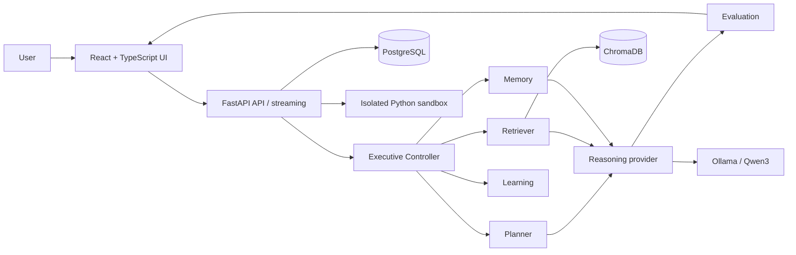

# NEXUS architecture

## Status

This is a proposed architecture derived from the supplied knowledge pack, not implemented architecture. No repository was available to validate it.

## Boundaries

The frontend renders state and submits commands; it does not choose server-side authorisation filters or execute tools. FastAPI owns authentication, validation, ownership checks, streaming, orchestration, and audit records. Ollama is a replaceable LLM provider. PostgreSQL is proposed for relational/run/checkpoint data; ChromaDB is proposed for retrieval and semantic memory.

## Run flow

Understanding produces validated structured data when needed. A deterministic Controller selects a tier and only enabled agents. Complex runs pause for plan approval before retrieval/reasoning. Tool calls are structured, allow-listed, and approval-gated. Evaluation can perform a bounded retry; all state transitions are persisted.

## Constraints

Treat retrieved/tool text as untrusted. Construct data scope filters internally from authenticated identity. Keep side effects out of interrupt nodes. Keep the sandbox isolated from the host, Docker socket, network, and user filesystem.
